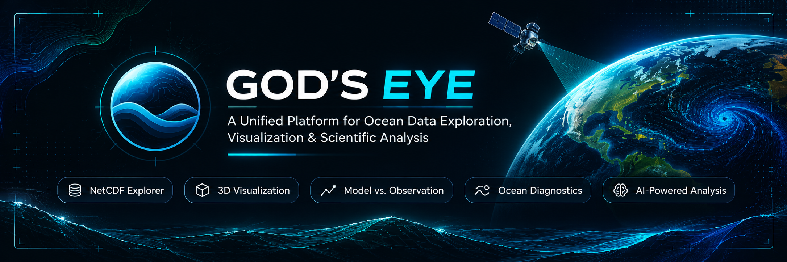

 

GOD'S EYE
A Unified Platform for Ocean Data Exploration, Visualization & Scientific Analysis

Explore · Visualize · Compare · Understand

 

    

  

Overview ·
Features ·
Architecture ·
Installation ·
API ·
Testing ·
Roadmap

🌊 Overview

GOD'S EYE is a full-stack scientific ocean-data exploration platform designed to make multidimensional oceanographic datasets accessible, interactive, and easier to analyze.

Built around a Python scientific-computing backend and an interactive web interface, the platform brings together NetCDF dataset ingestion, metadata inspection, three-dimensional ocean visualization, model-observation comparison, scientific diagnostics, and natural-language-assisted exploration.

Instead of treating oceanographic data as static scientific files, GOD'S EYE provides a unified workspace where users can inspect datasets, explore spatial and temporal dimensions, visualize ocean variables, and investigate scientific relationships.

The problem

Oceanographic datasets are often large, multidimensional, and difficult to interpret without specialized tooling. Researchers and students may need separate tools for data inspection, visualization, observation comparison, and analysis.

GOD'S EYE aims to bring these workflows into one coherent environment.

The approach
Ingest: Work with NetCDF oceanographic datasets.
Inspect: Explore variables, coordinates, dimensions, and metadata.
Visualize: Interact with three-dimensional ocean fields and depth slices.
Compare: Investigate model and observational data together.
Analyze: Access scientific diagnostics and structured exploration commands.
✨ Features

<table> <tr> <td width="50%">

🗂️ Dataset Workspace
NetCDF dataset upload.
Dataset metadata inspection.
Dimension and variable discovery.
Dataset session management.
Bundled demonstration datasets.

</td> <td width="50%">

🌐 3D Ocean Visualization
Interactive Three.js explorer.
Three-dimensional volume rendering.
Depth-slice exploration.
Ocean-current vector visualization.
Spatial and variable inspection.

</td> </tr> <tr> <td width="50%">

🔬 Scientific Analysis
Oceanographic diagnostics.
Temperature and salinity exploration.
Model-data interpolation.
Data quality and validity checks.
Confidence and evidence handling.

</td> <td width="50%">

📊 Model vs. Observation
Argo profile integration.
Observation lookup.
Model-observation collocation.
Comparison validity checks.
Scientific comparison workflows.

</td> </tr> <tr> <td width="50%">

🤖 Natural-Language Exploration
Structured command interpretation.
Allow-listed exploration operations.
Command validation.
Deterministic command execution.
Contextual scientific explanations.

</td> <td width="50%">

⚙️ Backend Services
FastAPI application.
xarray-based dataset processing.
Bounded data-access endpoints.
Binary visualization payloads.
Modular scientific services.

</td> </tr> </table>

🖥️ Platform Architecture

GOD'S EYE follows a modular full-stack architecture that separates the user interface, API layer, scientific processing, and visualization responsibilities.

flowchart TB
    USER["User"]

    subgraph FRONTEND["Frontend — React + Vite"]
        UI["Dataset Workspace"]
        EXPLORER["3D Ocean Explorer"]
        COMMAND["Natural Language Interface"]
    end

    subgraph BACKEND["Backend — FastAPI"]
        API["REST API"]
        UPLOAD["Dataset Upload Service"]
        DATASET["Dataset Services"]
        OBS["Observation Services"]
        COMPARE["Comparison Services"]
        DIAG["Diagnostics Services"]
        AI["Command Parser & Executor"]
    end

    subgraph SCIENCE["Scientific Processing"]
        XR["xarray / NumPy"]
        INTERP["Interpolation"]
        QC["Quality & Validity"]
        COLLOC["Spatial Collocation"]
    end

    DATA["NetCDF / Argo Profiles"]

    USER --> UI
    USER --> EXPLORER
    USER --> COMMAND

    UI --> API
    EXPLORER --> API
    COMMAND --> API

    API --> UPLOAD
    API --> DATASET
    API --> OBS
    API --> COMPARE
    API --> DIAG
    API --> AI

    UPLOAD --> DATASET
    DATASET --> XR
    OBS --> COLLOC
    COMPARE --> INTERP
    COMPARE --> QC
    DIAG --> XR

    XR --> DATA
    COLLOC --> DATA
    INTERP --> DATA
    AI --> DATASET
Technology Stack
Layer	Technologies
Backend	Python 3.12+, FastAPI, Uvicorn
Scientific Computing	xarray, NumPy, pandas, SciPy
Scientific Data	NetCDF, Argo profiles
Frontend	React, TypeScript, Vite
3D Visualization	Three.js
API Communication	HTTP / REST
Validation	Pydantic
Testing	pytest, HTTPX
Dependency Management	uv, npm
Packaging	Docker, Docker Compose
📁 Project Structure
Godseye-main/
│
├── frontend/
│   ├── public/
│   │   └── ocean.html
│   ├── src/
│   │   ├── App.tsx
│   │   ├── main.tsx
│   │   └── styles.css
│   ├── package.json
│   ├── package-lock.json
│   └── vite.config.ts
│
├── src/
│   └── ocean_backend/
│       │
│       ├── ai/
│       │   ├── commands.py
│       │   ├── executor.py
│       │   ├── narrator.py
│       │   ├── parser.py
│       │   ├── schemas.py
│       │   └── validator.py
│       │
│       ├── api/
│       │   ├── main.py
│       │   └── routes/
│       │       ├── ai.py
│       │       ├── comparison.py
│       │       ├── diagnostics.py
│       │       ├── observations.py
│       │       ├── upload.py
│       │       └── visualization.py
│       │
│       ├── data/
│       │   ├── argo/
│       │   ├── model_3d.nc
│       │   ├── model_4d.nc
│       │   └── observation_store.py
│       │
│       ├── models/
│       │   ├── datasets.py
│       │   ├── evidence.py
│       │   └── schemas.py
│       │
│       ├── science/
│       │   ├── collocation.py
│       │   ├── comparison.py
│       │   ├── diagnostics.py
│       │   ├── interpolation.py
│       │   ├── model_support.py
│       │   ├── validity.py
│       │   └── confidence.py
│       │
│       └── services/
│           ├── dataset_service.py
│           ├── model_service.py
│           ├── upload_service.py
│           ├── visualization_service.py
│           └── observation_resolver.py
│
├── tests/
│
├── docs/
│   ├── assets/
│   │   └── godseye-banner.png
│   └── PROJECT_STATUS.md
│
├── pyproject.toml
├── uv.lock
├── run.py
├── Dockerfile
├── docker-compose.yml
├── .env.example
├── .gitignore
└── README.md
🚀 Getting Started
Prerequisites
Requirement	Version
Python	3.12–3.13
Node.js	20.19+ or 22.12+
npm	Compatible with installed Node.js
uv	Latest stable
1. Clone the repository
git clone https://github.com/SIH-2026-Projects/Godseye.git
cd Godseye
2. Install backend dependencies

From the project root:

uv sync --extra dev

This installs the backend dependencies and development tools.

3. Install frontend dependencies
cd frontend
npm ci
4. Build the frontend
npm run build

Return to the root directory:

cd ..
5. Start the application
uv run python run.py

The FastAPI application serves the production frontend when the frontend build is available.

6. Open GOD'S EYE
Service	URL
Main application	http://127.0.0.1:8000
Ocean explorer	http://127.0.0.1:8000/ocean.html
Interactive API documentation	http://127.0.0.1:8000/docs
Health endpoint	http://127.0.0.1:8000/health
💻 Frontend Development

For Vite hot reloading, run the frontend separately.

Terminal 1 — Backend

uv run python run.py

Terminal 2 — Frontend

cd frontend
npm run dev

Open the Vite URL shown in the terminal, normally:

http://localhost:5173

Keep both processes running during full-stack development.

🔌 API Reference

The backend exposes REST endpoints grouped by responsibility.

Route group	Responsibility
/health	Backend health
/datasets	Dataset upload and dataset access
/visualization	Volume, slice, vector, and point data
/comparison	Model-observation comparison
/diagnostics	Scientific diagnostics
/ai	Structured natural-language commands

The exact request and response schemas are documented by the running FastAPI application.

Interactive API reference:

http://127.0.0.1:8000/docs

🧪 Testing & Quality Checks

Run the backend test suite:

uv run pytest -q

Run Ruff:

uv run ruff check .

Build the frontend:

cd frontend
npm run build
Latest recorded verification
Check	Recorded result
Python compilation	Passed
Backend test suite	119 passed
Health endpoint smoke test	Passed
Bundled dataset metadata	Passed
Observation endpoint	Passed
Visualization manifest	Passed
Frontend production build	Not verified in handoff environment
Ruff lint	Not verified in handoff environment

These results describe the handoff verification, not a guarantee about every subsequent repository change. Re-run the checks on the current branch.

🌍 Scientific Data

GOD'S EYE works with multidimensional oceanographic datasets.

A typical dataset may contain dimensions such as:

Time
Depth
Latitude
Longitude

Example variables:

Variable	Meaning
thetao	Sea water potential temperature
so	Sea water salinity
uo	Eastward sea water velocity
vo	Northward sea water velocity

Variable names, units, dimensions, and coordinate conventions vary between datasets. The backend should validate actual metadata instead of assuming every NetCDF file follows one schema.

Demo data

The repository includes small synthetic demonstration fixtures for exercising the application.

Important: These fixtures are synthetic educational data. They are not measurements from actual Argo floats, operational ocean forecasts, or validated ocean reanalysis products. Do not use them to draw scientific conclusions.

⚠️ Data Handling & Operational Notes

The current implementation has several important boundaries:

Dataset sessions are held in an in-memory registry.
Restarting the backend clears active sessions.
Uploaded files are stored locally under data/uploads/.
There is no user authentication, authorization, or multi-tenant isolation.
The upload-size ceiling is a technical limit, not a recommended deployment target.
The 3D explorer imports Three.js from jsDelivr, so its WebGL renderer requires network access.
The API remains the source of scientific values; a visualization fallback must not be mistaken for scientific data.

Do not expose an untrusted public deployment containing private datasets until authentication, authorization, storage isolation, and resource controls are implemented.

🗺️ Roadmap

The following are engineering priorities, not claims of already completed functionality.

Bundle Three.js locally through the frontend build.

Add persistent dataset sessions and recovery.

Implement dataset deletion and retention controls.

Add authentication and authorization.

Introduce per-user dataset isolation.

Improve large-dataset processing and memory efficiency.

Validate against authoritative oceanographic and Argo datasets.

Expand support for CF conventions, calendars, curvilinear grids, and missing-value patterns.

Add end-to-end upload-to-visualization integration tests.

Add frontend build checks and linting to CI.

Improve deployment observability and operational documentation.

🤝 Contributing

Contributions are welcome.

When proposing changes:

Keep API, scientific processing, and visualization responsibilities modular.
Preserve scientific metadata and coordinate semantics.
Handle missing values and unsupported data explicitly.
Add tests for new behavior and failure paths.
Document scientific assumptions and limitations.
Avoid presenting unvalidated output as scientifically authoritative.

For significant architectural changes, open an issue first to discuss the design.

🔐 Security

Please do not commit:

API keys or credentials.
Private datasets.
Personal information.
Local .env files.

Use .env.example for documented configuration placeholders.

If you discover a security issue, report it privately to the repository maintainers rather than publishing sensitive details in an issue.

📄 License

Check the repository's LICENSE file for the applicable license.

GOD'S EYE

Making the ocean easier to explore, visualize, and understand.

 

